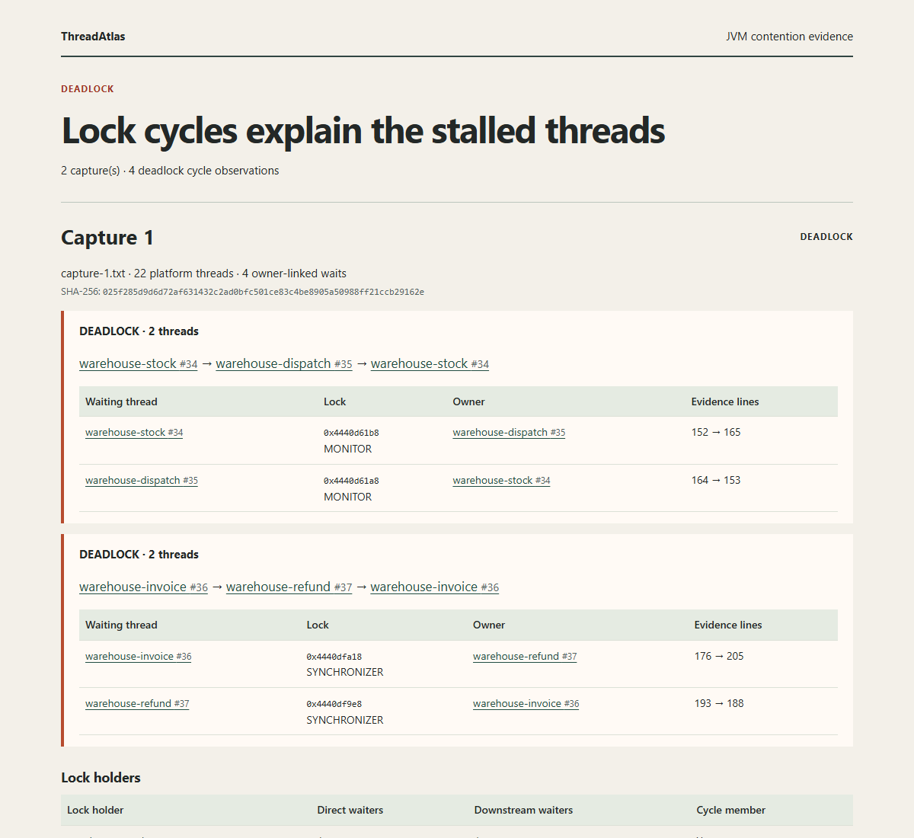

# ThreadAtlas

A service stops responding. The thread dump has hundreds of stacks. Which thread holds the lock, how many requests are waiting behind it, and is there an actual cycle?

ThreadAtlas reads **HotSpot platform-thread dumps** and builds the observed lock ownership graph. It identifies monitor and ownable-synchronizer cycles, ranks lock holders by affected threads, and groups matching stacks across captures. Reports are available as standalone HTML, JSON, and through a read-only MCP server.



## Start with a real deadlock

Download the [0.1.0 release](https://github.com/Almeida96/threadatlas/releases/tag/v0.1.0). Unzip `warehouse-captures.zip` and open `deadlock/analysis/report.html` to inspect the result without installing anything.

To reproduce the captures, extract the CLI distribution and run it with **JDK 21**:

```sh
bin/threadatlas demo --out warehouse
```

On Windows, use `bin\threadatlas.bat`. Analysis and MCP need Java 21; the demo also needs `jcmd` from the same JDK.

The demo starts three disposable JVMs and captures each twice:

| JVM | What it does | Observed result |
| --- | --- | --- |
| `deadlock` | Two workers acquire monitors in opposite order; two more do the same with `ReentrantLock`. | Two distinct deadlock cycles in each capture. |
| `convoy` | One worker holds a monitor while four requests wait for it. | Contention with four downstream waiters; no cycle. |
| `idle` | Workers wait on a condition and an object notification. | No owner-linked waits or lock cycles. |

These are actual `jcmd Thread.print -l` outputs, not hand-written demonstrations. Each folder also contains `mxbean.json`, recorded independently with Java’s management API. The verification script compares the analyzer’s cycle participants, thread states and owner relationships with that evidence. The demo terminates only the JVMs it starts.

## Analyze an incident

Capture the affected process with a matching JDK and an account allowed to attach to it:

```sh
jcmd 12345 Thread.print -l > capture-1.txt
# Capture again when useful for your investigation.
jcmd 12345 Thread.print -l > capture-2.txt

bin/threadatlas analyze --dump capture-1.txt --dump capture-2.txt --out incident-001
```

Use UTF-8 files. In PowerShell, capture with `jcmd 12345 Thread.print -l | Set-Content -Encoding utf8 capture-1.txt`.

Provide captures in chronological order. Output directories must be new. The analysis command reads local files; it does not attach to a process, connect to a remote JVM or upload diagnostics.

Open `incident-001/report.html`. Each cycle lists the waiter, lock, owner and source line numbers. Thread names link to their stacks. The holder table counts direct waiters and threads further down the chain; the JSON includes every holder, while HTML shows the top 20.

| Verdict | Meaning |
| --- | --- |
| `DEADLOCK` | At least one capture contains a closed ownership cycle without a timed acquisition. |
| `CONTENTION` | Owner-linked waits were observed, but no untimed cycle was found. |
| `NO_CYCLE_OBSERVED` | No owner-linked wait was established in the supplied evidence. This is not a health verdict. |

A cycle involving `TIMED_WAITING` is recorded as `TIMED_CYCLE`, under contention, because an acquisition timeout can break it. Missing or inconsistent monitor ownership appears in `unresolved` instead of becoming an invented edge. Ordinary condition waits and parks without an observed owner do not count as lock contention.

The report’s overall verdict reflects the most severe observation across the inputs. It does not claim an earlier deadlock is still present in the final capture.

| Exit code | Meaning |
| --- | --- |
| 0 | Report written; the selected failure policy was not triggered. |
| 1 | Report written with a deadlock, or contention when using `--fail-on contention`. |
| 2 | Invalid or unsupported input, existing output, or execution error. |

## Ask an agent about the evidence

Bind the MCP server to one completed report:

```json
{
  "mcpServers": {
    "threadatlas": {
      "command": "java",
      "args": ["-cp", "/opt/threadatlas/lib/*", "io.github.almeida96.threadatlas.MainKt",
               "mcp", "--report", "/reports/incident-001/report.json"]
    }
  }
}
```

All tools are read-only and return structured JSON plus equivalent text:

| Tool | Example question |
| --- | --- |
| `incident_summary` | Which captures contain cycles, and are there coverage gaps? |
| `list_threads` | Which BLOCKED threads belong to the warehouse workers? |
| `thread_detail` | What stack and source lines belong to this thread? |
| `wait_chain` | Follow this request’s wait to its owner, then to the next owner. Does it loop? |
| `list_stacks` | Which state and stack signatures recur across captures? |

Thread tools require a snapshot index. They accept `offset` and `limit` (1–100), so an agent can inspect selected evidence without loading every stack. Thread IDs and lock addresses are scoped to a single capture. The server cannot select another report, invoke `jcmd`, kill a thread or execute a command.

Try: *“Read the warehouse incident. Find the request threads, follow their wait chains, and identify the lock holder with the most downstream waiters. Give the source line numbers and distinguish contention from deadlock.”*

## Interpretation boundaries

- Tested with HotSpot JDK 21 text from `Thread.print -l` on Windows and Linux. Input must have one full-dump header, Java thread states, and the `JNI global refs` terminator. Truncated files, concatenated dumps and duplicate thread IDs are rejected.
- Covers platform threads. Virtual-thread dumps, OpenJ9 formats, JFR recordings and coroutine dumps are not supported.
- Graph edges require an observed owner in the same capture. Monitor addresses are normalized; they are never matched between captures. An `Object.wait()` annotation releases its waited-on monitor even if a stack frame also lists that monitor as locked.
- The Java deadlock footer is ignored. The tool reconstructs cycles from thread bodies. Native locks, read-lock ownership that is not reported, and waits outside this evidence can be invisible.
- Stack grouping uses the state and first eight frame strings. A repeated stack does not prove continuous blocking. `RUNNABLE` does not establish CPU activity. No latency, elapsed blocking time or utilization is inferred.
- Dumps and reports can contain internal class names, thread names and business identifiers. Review them before sharing with a model or another person.

Limits: 16 captures, 16 MiB per capture, 64 MiB combined, 20,000 platform threads per capture and 512 frames per thread. Lock graph construction and traversal are linear in the number of threads and lock annotations; ranking and stack sorting add sorting costs. The implementation uses iterative walks, including for long blocker chains.

## Development

Kotlin/JVM supplies the parser, graph analysis, report generation and CLI. Java supplies the stdio protocol adapter and the disposable diagnostic fixture. The only application library besides the Kotlin runtime is Jackson.

```sh
./gradlew test installDist distZip
build/install/threadatlas/bin/threadatlas demo --out build/warehouse
python checks/mxbean_oracle.py --demo build/warehouse
```

For MCP interoperability, install the test-only Python package `mcp==1.26.0` in a virtual environment, then run:

```sh
python checks/mcp_smoke.py --install-dir build/install/threadatlas \
  --report build/warehouse/deadlock/analysis/report.json
```

CI runs on Linux and Windows. The suite covers monitor release/reacquisition, synchronizers, timed cycles, ambiguous ownership, transitive waiters, malformed input, escaping and a 10,000-thread chain. The integration checks use JVM management data and the official MCP client.

The input and evidence model follow the JDK documentation for [jcmd](https://docs.oracle.com/en/java/javase/21/docs/specs/man/jcmd.html), [ThreadInfo](https://docs.oracle.com/en/java/javase/21/docs/api/java.management/java/lang/management/ThreadInfo.html) and [ThreadMXBean](https://docs.oracle.com/en/java/javase/21/docs/api/java.management/java/lang/management/ThreadMXBean.html).

[MIT license](LICENSE)
